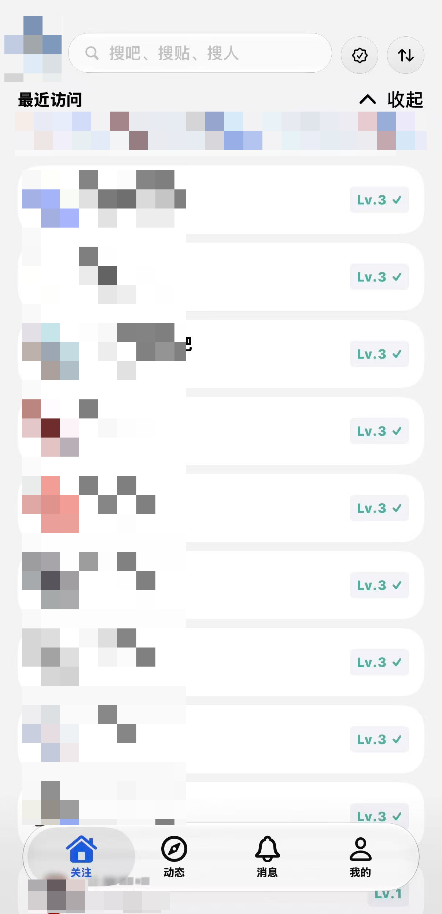
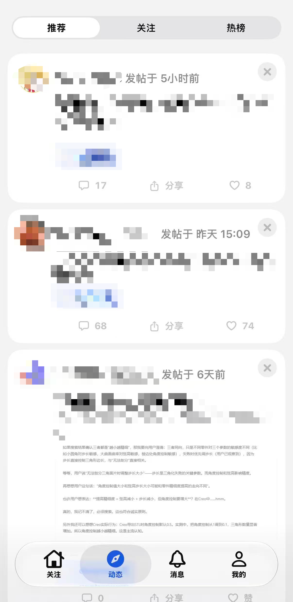
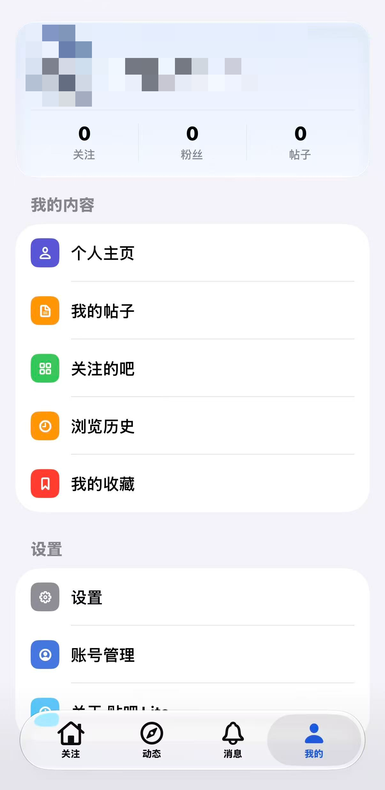
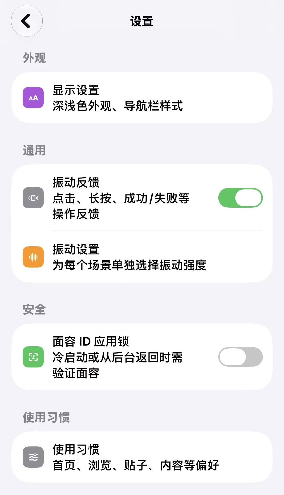

<div align="center">

# 贴吧 Lite-IOS

**第三方百度贴吧 iOS 客户端** ；本分支为 **iOS 15 移植版**（原版最低 iOS 17，见文末「iOS 15 移植」）

[](https://github.com/toamdou/TiebaLite-IOS/actions/workflows/build-ipa.yml)


<!-- ═══════════ 真机演示图 ═══════════
     截图放 docs/screenshots/，覆盖同名文件即可更新：
     home.png（关注页）/ explore.png（动态页）/ profile.png（我的页）/ settings.jpg（设置页） -->





</div>

---

## ✨ 功能一览

### ✅ 已实现

**浏览**

- ✅ 关注页：关注吧列表、最近访问、关注吧动态
- ✅ 动态页：推荐 / 关注 / 热榜
- ✅ 吧页：分类浏览、排序、吧资料、单吧签到、关注 / 取关
- ✅ 帖子页：楼层列表、楼中楼（子回复）、父回复引用、楼层排序
- ✅ 搜索：吧 / 帖 / 人
- ❓ 消息中心：回复我的 / 提到我的（未经测试，可能存在Bug）
- ✅ 用户主页：资料与发帖浏览
- ✅ 历史记录与收藏夹

**互动**

- ✅ 登录：百度通行证 WebView 授权
- ✅ 点赞 / 取消点赞（帖子、楼层）
- ✅ 收藏 / 取消收藏帖子
- ✅ 一键签到：批量吧签到（**本分支**：进度走页内 pill + 前台本地通知；Live Activity 已移除，见下方「iOS 15 移植」）

**体验**

- ✅ 深色模式（含 AMOLED 纯黑）
- ⚠️ 液态玻璃顶栏 / 底栏与原生转场（**本分支关闭**：任何系统版本都走 iOS 17/18 的经典材质；见「iOS 15 移植」）
- ✅ 触感反馈
- ✅ 图片查看器
- ✅ 视频播放
- ✅ 广告 / 直播内容过滤
- ❓ 屏蔽：屏蔽词 / 屏蔽用户 / 屏蔽吧
- ✅ 阅读字号、省流量模式、图片加载质量三档
- ✅  App scheme 深链
- ✅ iPad 适配

### ❌ 未实现

- ❌ 发帖 / 回复 / 楼中楼发言 —— 只读 + 轻互动，无法发言
- ❌ 私信
- ❌ 推送通知（应用不带推送权限）
- ❌ 直播观看（信息流中已过滤）
- ❌ 投票等帖子内互动插件

## 📁 项目结构

```
TiebaLite/                  App 目标：入口、Info.plist、资源、Icon Composer 图标
Extensions/TiebaLiveActivity/ 灵动岛扩展（独立 target）—— **本分支不内嵌**（ActivityKit 是 16.1 起），源码保留以便回退
Sources/TiebaNative/        主模块（唯一 Swift module，按功能分区）
  Compat/                     iOS 15 移植层（空态替身 + 液态玻璃总开关 TiebaGlass）
  App/                        引导、会话、路由与导航壳、深链、更新
  Core/                       存储（SQLite/KV/Keychain/Cookie）、偏好、后台任务、触觉、几何
    Networking/               所有 HTTP API 客户端
    Proto/                    protobuf 编解码、视图模型映射、生成代码
  UI/                         Chrome（顶栏/底栏）、通用控件、原生行列表、图片与查看器
  Features/                   按页面分：Home / Explore / Forum / Thread / Search
                              / Profile / Messages / Settings / Auth / Web
Vendor/                     源码内嵌的第三方库（Nuke、JXPhotoBrowser、SwiftProtobuf）
Signing/                    设备签名描述文件（内容不入库，脚本/CI 现场生成占位件）
scripts/                    build-ipa.sh（mac 一条命令出 IPA）、verify-port.py（iOS 15 可用性静态自查）
docs/ios15-port.md          iOS 15 移植说明：改了什么、怎么出 IPA、产物自检判据
```

构建入口与标签：`bazel build //:App`，主模块 `//Sources/TiebaNative:TiebaNative`。


## 🛠 出 IPA（未签名）

编译必须有 **macOS + Xcode 26**（iOS 26 分支要 26 SDK，部署底线又是 15.0）；不需要任何 Apple 账号或 secret。

**A. 有 mac：一条命令**

```bash
bash scripts/build-ipa.sh          # → dist/TiebaLite-2.2.0-iOS15.ipa
bash scripts/build-ipa.sh debug    # Debug 包
```

**B. 没有 mac：GitHub Actions**

推到自己的仓库 → **Actions** → **Build iOS 15 Unsigned IPA** → **Run workflow** → 下载 Artifact `ipa-ios15`。

**C. 只有 Windows/Linux**：可以改代码 + 跑 `python3 scripts/verify-port.py` 静态自查，IPA 走 A 或 B。

产物自检（脚本与 CI 同一套判据）：`Info.plist MinimumOSVersion == 15.0`、Mach-O `minos 15.0`、
`otool -L` 不含 `ActivityKit`、无 `PlugIns/*.appex`。细节见 [docs/ios15-port.md](docs/ios15-port.md)。

## 📱 安装（iOS 15+）

CI / 脚本产出的是**未签名 IPA**，按你的机器二选一：

- **TrollStore**（14.0 ~ 16.6.1 / 17.0 支持的版本）：直接导入 `.ipa` 安装，无需签名；
- **SideStore / AltStore / Sideloadly**：用自己的 Apple ID 重签后侧载。免费 Apple ID 限制：签名 **7 天**
  有效（SideStore 可自动刷新）、最多同时签 **3 个 App**、推送 / App Groups 等能力不可用。

## 🧩 iOS 15 移植（本分支相对上游 v2.2.0 的差别）

上游最低 iOS 17。本分支把部署底线降到 **15.0**，业务代码一行没动，只处理「系统件在 15 上没有」的地方。
完整说明与自检判据见 [docs/ios15-port.md](docs/ios15-port.md)。

| 系统件 | 起于 | 本分支处理 | 15 上的表现 |
|---|---|---|---|
| `UIContentUnavailableView/Configuration` | iOS 17 | 换成 `Compat/` 里的同名替身（`TiebaContentUnavailable*`，字段与系统一致） | 空/错/加载态排版由本仓画，布局语义不变 |
| `registerForTraitChanges` | iOS 17 | 13 处调用包进 `#available(iOS 17.0, *)` | 系统深浅/字号切换不实时重绘，重开 App 生效 |
| `UIEditMenuInteraction` | iOS 16 | 装配/弹出/收起全部包进 `#available(iOS 16.0, *)` | 长按选词仍有选择高亮，但不弹系统编辑菜单 |
| `UITextViewDelegate` 的 `UITextItem` / `editMenuForTextIn` | 17 / 16 | 方法加 `@available` | 链接「显示文字≠真实地址」确认框等不回 | 
| `ActivityKit` / Live Activity | iOS 16.1 | 整条链路改空实现 + 移除扩展目标 | 无灵动岛/锁屏进度；签到进度走页内 pill + 前台通知 |
| `UIFont.Width` / `TraitKey.width` | iOS 16 | 15 上忽略自定义字宽 | 窄体/宽体按标准宽度渲染 |
| `Detent.custom(identifier:resolver:)` | iOS 16 | 15 上退化为 `.medium()` / `.large()` | 半屏表单只有两档高度 |
| `Task.sleep(for:)` | iOS 16 | 改 `Task.sleep(nanoseconds:)` | 无差异 |
| `UIWindowScene.effectiveGeometry` | iOS 16 | 15 上读 `interfaceOrientation` | 无差异 |
| iOS 26 液态玻璃 | iOS 26 | 加总开关 `TiebaGlass.isEnabled = false` + `UIDesignRequiresCompatibility` | **任何系统版本**都没有液态玻璃 |

静态自查（没有 Xcode 也能跑，跨平台）：

```bash
python3 scripts/verify-port.py             # 未兜住的 ≥iOS16 系统件命中 → 退出码 1
python3 scripts/verify-port.py --self-test # 扫描器自证
```

当前结果：768 个 `.swift`、63 处系统件命中**全部**被 `#available` / `@available` 兜住，未兜住 **0**。

已在 macOS runner 上真实编译通过（Actions run `40322555788`，Xcode 26.5 / Bazel 9.2.0）：

```
TiebaLite-2.2.0-iOS15.ipa   4.4 MB
arm64 · LC_BUILD_VERSION minos 15.0.0 / sdk 26.5.0 · MinimumOSVersion 15.0
56 条 LC_LOAD_DYLIB 无 ActivityKit · 无 PlugIns/ · 无内嵌 Frameworks/
```

## 🙏 致谢

本项目站在这些项目的肩膀上：

- [HuanCheng65/TiebaLite](https://github.com/HuanCheng65/TiebaLite) — Kotlin 原版
- [zzc10086/TiebaLite](https://github.com/zzc10086/TiebaLite) — Kotlin 版 fork
- [Starry-OvO/aiotieba](https://github.com/Starry-OvO/aiotieba) — 贴吧协议字段参考
- [n0099/tbclient.protobuf](https://github.com/n0099/tbclient.protobuf) — 百度贴吧客户端 protobuf 定义合集

## 📄 许可证

本项目以 [GPL-3.0](LICENSE) 协议开源。

## ⚠️ 免责声明

本软件及源码**仅供学习交流使用，严禁用于商业用途**。本项目与百度官方无关，贴吧相关 API 与数据版权归百度所有，使用本项目产生的一切后果由使用者自行承担。
